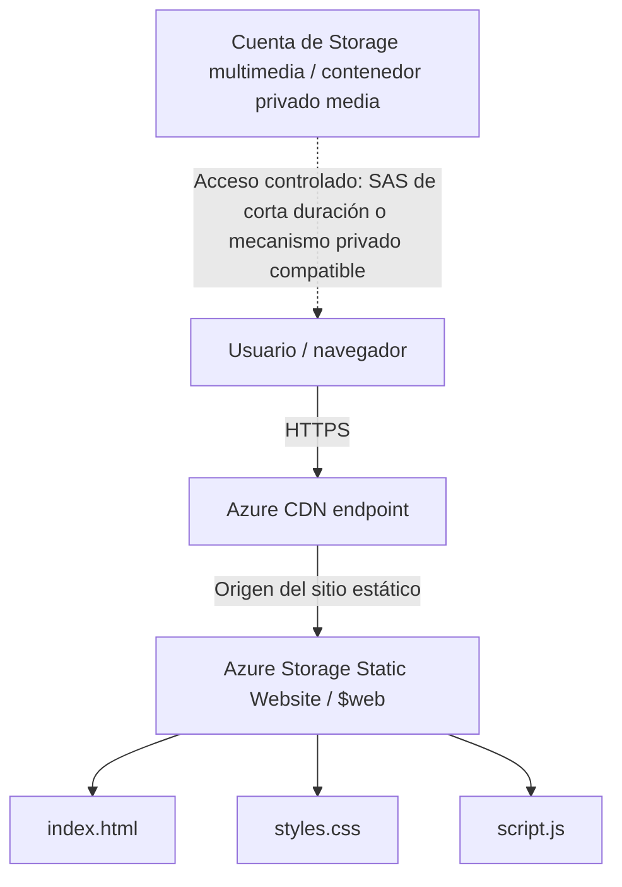

# Zentrix | Arquitectura web estática con Azure Storage y CDN

Panel web demostrativo de **Zentrix**, una iniciativa tecnológica enfocada en desarrollo de software, sistemas de gestión, control de acceso y automatización. Este repositorio se adapta a la práctica académica de publicación de un sitio estático mediante **Azure Storage Static Website** y distribución a través de una CDN.

> **Estado del proyecto:** frontend estático listo para probar y desplegar. La creación de cuentas de Azure, la configuración de Storage/CDN y las pruebas de caché deben realizarse en la suscripción del estudiante. No se incluyen credenciales, tokens SAS ni URLs de infraestructura inventadas.

## Tabla de contenido

- [Objetivo](#objetivo)
- [Tecnologías](#tecnologías)
- [Estructura del proyecto](#estructura-del-proyecto)
- [Características](#características)
- [Arquitectura objetivo](#arquitectura-objetivo)
- [Ejecución local](#ejecución-local)
- [Despliegue en Azure](#despliegue-en-azure)
- [Seguridad y acceso a multimedia](#seguridad-y-acceso-a-multimedia)
- [Pruebas y evidencias](#pruebas-y-evidencias)
- [Decisiones técnicas](#decisiones-técnicas)
- [Pendientes antes de entregar](#pendientes-antes-de-entregar)
- [Autoría](#autoría)

## Objetivo

Construir y documentar un frontend estático responsivo, alojarlo en Azure Storage Static Website y distribuirlo mediante un endpoint CDN HTTPS. La práctica separa el frontend de los recursos multimedia y aplica buenas prácticas de manipulación del DOM para reducir el riesgo de XSS.

## Tecnologías

- **HTML5:** estructura semántica del panel.
- **CSS3:** diseño adaptable con CSS Grid y Flexbox.
- **JavaScript ES6+:** selección de elementos con `querySelector()` y `querySelectorAll()`; actualización segura de texto con `textContent`.
- **Microsoft Azure Storage:** hosting del frontend estático en `$web` y contenedor independiente para multimedia.
- **Azure CDN:** distribución del contenido desde un endpoint HTTPS, de acuerdo con las opciones disponibles en la suscripción y región.
- **Git y GitHub:** control de versiones y publicación del código fuente.

## Estructura del proyecto

```text
zentrix-azure-cdn/
├── index.html       # Página principal del panel
├── styles.css       # Diseño responsivo, Grid y Flexbox
├── script.js        # Fecha, año e indicadores demostrativos
└── README.md        # Documentación del proyecto y despliegue
```

## Características

- Panel de Zentrix con navegación lateral y secciones de resumen, servicios, áreas de trabajo, información y contacto.
- Indicadores de ejemplo claramente identificados como datos simulados.
- Diseño responsivo para escritorio, tabletas y dispositivos móviles.
- CSS Grid para la estructura bidimensional de la aplicación y para las tarjetas.
- Flexbox para alinear navegación, encabezados, indicadores y componentes.
- JavaScript actualiza la fecha, el año y los indicadores mediante `textContent`.
- No se usa `document.write()` ni `.innerHTML` para insertar datos dinámicos.
- Las ilustraciones actuales se generan con CSS; por tanto, el sitio funciona sin depender de imágenes externas.

## Arquitectura objetivo



El frontend se publica en `$web`. Los archivos multimedia se mantienen separados en una cuenta de almacenamiento distinta y con acceso público anónimo deshabilitado. La CDN debe configurarse con el origen correcto y HTTPS. La forma de autorizar la distribución de contenido privado depende de las capacidades que admita el SKU/servicio CDN disponible; no debe suponerse que un origen privado queda protegido automáticamente por apuntar a su URL.

## Ejecución local

No se requiere instalar dependencias ni un proceso de compilación.

1. Clona el repositorio o descarga los archivos.
2. Abre la carpeta en Visual Studio Code.
3. Abre `index.html` en un navegador. Para una experiencia local más cómoda, puedes usar la extensión **Live Server**.
4. Comprueba la navegación, la fecha, el año y el diseño en distintos anchos de pantalla.

## Despliegue en Azure

### 1. Crear el repositorio de GitHub

La guía de la práctica solicita un repositorio público llamado `azure-static-cdn-architecture`. Inicializa Git en esta carpeta y publica los cuatro archivos del proyecto.

```bash
git init
git add index.html styles.css script.js README.md
git commit -m "feat: crear panel estático de Zentrix para Azure CDN"
git branch -M main
git remote add origin https://github.com/TU-USUARIO/azure-static-cdn-architecture.git
git push -u origin main
```

Reemplaza `TU-USUARIO` por tu usuario real de GitHub. Si ya existe un repositorio, no repitas `git init`; configura o revisa el remoto con `git remote -v`.

### 2. Crear la cuenta de Storage para el frontend

1. En Azure Portal, crea una cuenta de almacenamiento de uso general compatible con Static Website.
2. En **Data management / Static website** (los nombres pueden variar según el portal), habilita la función.
3. Configura `index.html` como documento de índice. Puedes dejar el documento de error sin definir o configurar una página de error si la práctica lo solicita.
4. Abre el contenedor `$web` generado y carga `index.html`, `styles.css` y `script.js` en la raíz del contenedor.
5. Guarda el **Primary endpoint** del sitio estático. Su hostname se utilizará como origen de la CDN.

> La web estática de Azure Storage publica los archivos del sitio mediante el endpoint web. La restricción de acceso anónimo del contenedor multimedia es una configuración distinta y no debe confundirse con el hosting público de la página.

### 3. Crear la cuenta de Storage multimedia

1. Crea una cuenta de almacenamiento independiente para recursos multimedia.
2. En la configuración de la cuenta, deshabilita **Allow Blob anonymous access** (o el ajuste equivalente del portal).
3. Crea un contenedor llamado `media` y deja el nivel de acceso público en **Private (no anonymous access)**.
4. Sube los recursos multimedia que utilice la aplicación, si decides incorporar imágenes o videos reales.
5. Conserva por separado el endpoint de la cuenta y los nombres de los blobs. No publiques claves de cuenta ni tokens SAS permanentes en GitHub.

En esta versión, las ilustraciones de la página están hechas con CSS y no necesitan blobs externos. El contenedor `media` se incluye como parte de la arquitectura de la práctica; puedes añadir recursos reales cuando hayas definido su mecanismo de acceso seguro.

### 4. Configurar Azure CDN

1. Crea el perfil y endpoint CDN que permita la suscripción y región utilizadas por la práctica.
2. Configura como origen el **hostname del endpoint de Static Website** de la cuenta frontend, sin `https://` ni rutas adicionales en el campo de hostname si el formulario lo solicita por separado.
3. Configura el protocolo de origen y el comportamiento de caché según las opciones disponibles y las instrucciones del laboratorio.
4. Habilita o espera la provisión de HTTPS/certificado administrado, si está disponible para el SKU seleccionado.
5. Accede a la URL HTTPS del endpoint CDN y comprueba que la página, CSS y JavaScript cargan correctamente.
6. Registra en este README la URL real que te asigne Azure y adjunta las evidencias solicitadas.

**Importante:** los productos y SKU de CDN de Azure han cambiado con el tiempo. Si el portal ya no permite crear el perfil indicado en la guía, consulta las opciones de distribución de contenido disponibles en tu suscripción y confirma con el docente cuál acepta la práctica. No documentes un endpoint como operativo hasta haberlo probado.

### 5. Actualizar contenido y caché

Después de subir cambios al contenedor `$web`, verifica la URL de origen y la URL CDN. Si la CDN devuelve una versión anterior, utiliza la opción de purga/invalidation disponible para el endpoint o espera el vencimiento de la caché según la configuración aplicada. Registra la prueba antes y después de la purga.

## Seguridad y acceso a multimedia

- El contenedor `media` debe permanecer privado; no configures **Blob** ni **Container** como acceso anónimo.
- Si una imagen privada debe mostrarse en el navegador, utiliza un mecanismo de autorización compatible y aprobado para el diseño desplegado, por ejemplo una URL SAS de solo lectura con expiración limitada, o una integración privada de origen/CDN que esté realmente soportada y configurada.
- Una URL SAS permite acceso a quien la posea hasta que expire o se revoque. No la incluyas en el repositorio, capturas públicas ni archivos compartidos sin protección.
- No coloques claves de Storage, cadenas de conexión ni secretos en HTML o JavaScript. Todo valor entregado al navegador debe considerarse visible para el usuario.
- La página utiliza `textContent` para insertar texto dinámico. No se utiliza `innerHTML` ni `document.write()` para esta tarea.
- Si se incorpora un formulario o datos de usuarios en el futuro, la validación del lado cliente no sustituye a la validación del servidor.

## Pruebas y evidencias

Añade capturas propias a una carpeta `evidence/` del repositorio (si la rúbrica permite publicarlas) y completa esta tabla con datos reales:

| Prueba | Resultado esperado | Evidencia a adjuntar |
|---|---|---|
| Sitio local | HTML, CSS y JS cargan correctamente | Captura del panel en navegador |
| Diseño responsivo | La navegación y tarjetas se adaptan a móvil | Capturas de escritorio y móvil |
| Endpoint de Static Website | La página devuelve contenido correctamente | Captura del endpoint de origen |
| Endpoint CDN HTTPS | La página abre con HTTPS válido | Captura de URL y certificado/indicador HTTPS |
| Caché CDN | Repetir la solicitud muestra comportamiento de caché conforme a la configuración | Cabeceras de respuesta o herramienta de diagnóstico disponible |
| Blob privado | El acceso anónimo directo al blob se deniega | Respuesta 403 o equivalente del recurso privado |
| Acceso autorizado | El recurso se sirve solo mediante el mecanismo autorizado elegido | Respuesta correcta por SAS vigente o integración privada probada |

No afirmes que una prueba pasó hasta haberla ejecutado. Los códigos y cabeceras exactos pueden variar según la configuración de Storage, CDN y las herramientas utilizadas.

### Comprobaciones útiles

En una terminal con `curl`, puedes inspeccionar las cabeceras de una URL real:

```bash
curl -I "https://TU-ENDPOINT-CDN/"
```

Para probar el blob privado, usa la URL real del blob **sin token SAS** y confirma que el acceso anónimo es rechazado:

```bash
curl -I "https://TU-CUENTA.blob.core.windows.net/media/TU-ARCHIVO.jpg"
```

Sustituye los valores de ejemplo por los endpoints y nombres reales. No compartas una URL SAS completa en capturas públicas. Si el servicio responde con una redirección, un error distinto o una cabecera de caché diferente, registra el resultado real y revisa la configuración antes de concluir.

## Decisiones técnicas

### CSS Grid y Flexbox

CSS Grid se utiliza para definir la estructura general del panel en áreas explícitas (`header`, `sidebar`, `content` y `footer`) y para distribuir grupos de tarjetas en dos dimensiones. Flexbox se utiliza para alinear elementos en una sola dimensión, como la navegación, encabezados, indicadores y botones. Las media queries reorganizan el panel para pantallas pequeñas.

### Mitigación de XSS en el DOM

El script selecciona nodos con `querySelector()` y actualiza texto con `textContent`. Esta propiedad inserta contenido como texto, no lo interpreta como marcado HTML, y reduce el riesgo de que cadenas no confiables se ejecuten como HTML. La página no usa `document.write()` ni `innerHTML` para datos dinámicos.

### Separación de almacenamiento

El frontend y los recursos multimedia se separan para facilitar mantenimiento y aplicar políticas distintas: `$web` sirve el sitio estático, mientras que `media` se mantiene privado. El acceso a multimedia requiere una autorización configurada y verificada por separado.

## Pendientes antes de entregar

- [ ] Publicar el código en el repositorio GitHub solicitado.
- [ ] Crear y configurar las cuentas de Storage en Azure.
- [ ] Habilitar Static Website y subir los tres archivos al contenedor `$web`.
- [ ] Crear el contenedor privado `media` y verificar que no permite acceso anónimo.
- [ ] Configurar CDN con el origen correcto y acceso HTTPS.
- [ ] Ejecutar pruebas de origen, CDN, caché y privacidad del blob.
- [ ] Añadir capturas propias y registrar resultados reales.
- [ ] Reemplazar los placeholders de este README con los enlaces reales, sin añadir secretos.

## Autoría

**Proyecto:** Zentrix — tecnología aplicada  
**Contexto académico:** práctica de Azure Storage y CDN  
**Institución:** Tecnológico Nacional de México  
**Repositorio:** `https://github.com/TU-USUARIO/azure-static-cdn-architecture` *(reemplazar por el enlace real)*  
**URL CDN HTTPS:** *(añadir cuando el endpoint esté creado y validado)*

---

Este proyecto es una demostración académica. Los indicadores y las ilustraciones son conceptuales; no implican que existan dispositivos conectados, datos de producción ni clientes activos.
